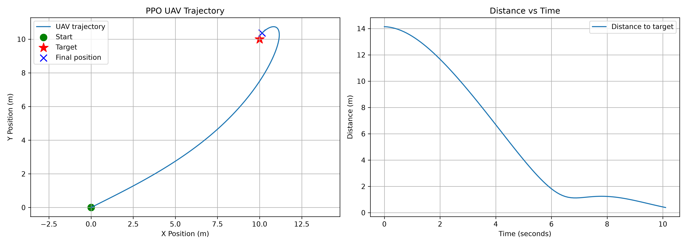
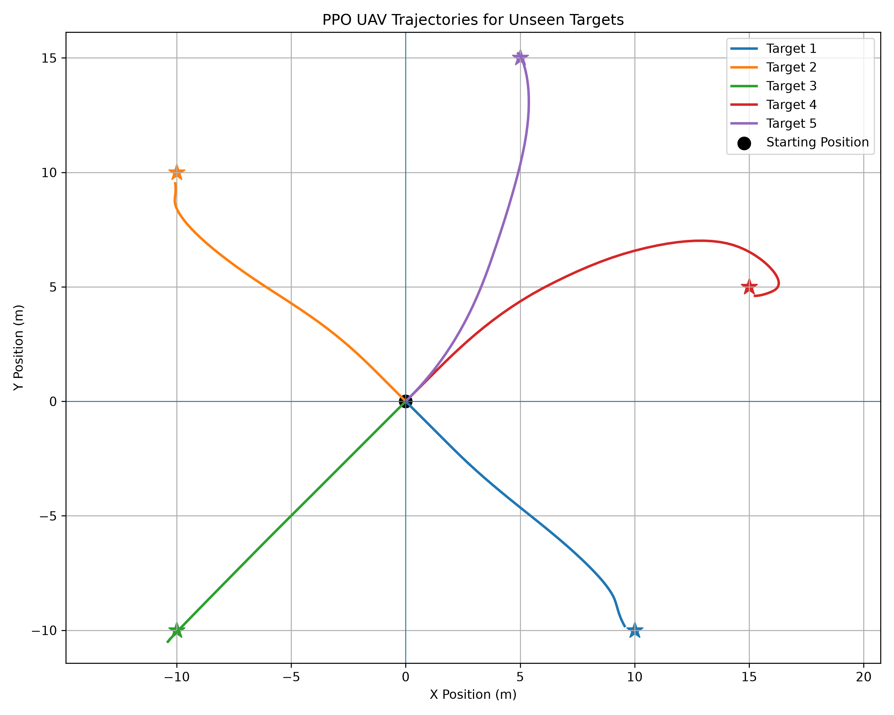
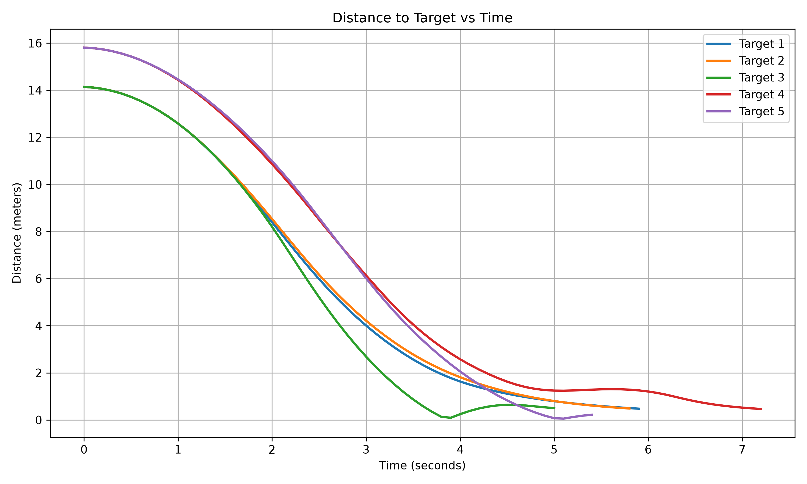
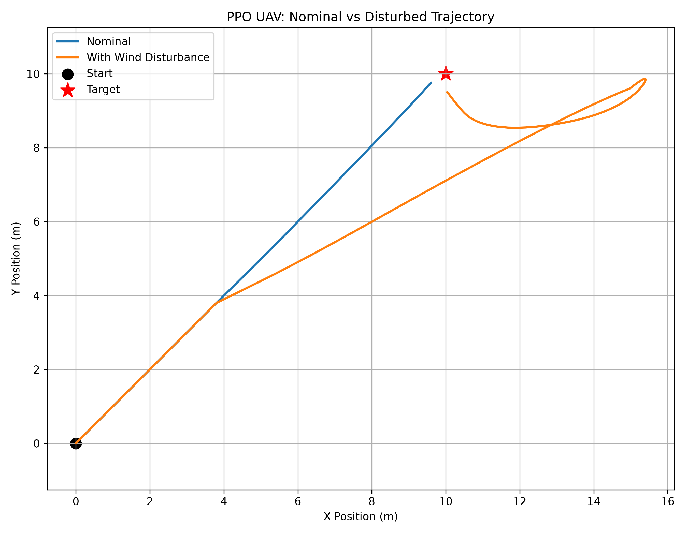
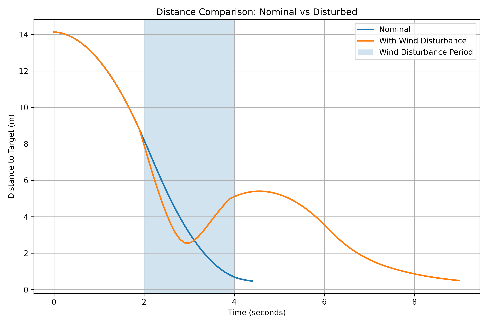

# PPO-Based Target Navigation for a Simplified 2D UAV

A reinforcement learning project that trains a Proximal Policy Optimization (PPO) agent to navigate a simplified 2D UAV-inspired point-mass model toward a target position.

## Project Overview

This project explores how reinforcement learning can be used for autonomous target navigation.

The UAV is represented as a point mass moving in a 2D environment. A PPO agent observes its relative position to the target and its velocity, then selects acceleration commands to reach the target while reducing its speed.

The project was developed incrementally, covering dynamics modeling, Gymnasium environment development, environment validation, PPO training, policy evaluation, visualization, and additional experiments.

**Important:** This is a simplified 2D point-mass model inspired by UAV navigation. It is not a full quadrotor simulation and does not model attitude, thrust, motor dynamics, or 3D flight.

## Project Objectives

1. Develop a simplified 2D UAV dynamics model.
2. Create a custom reinforcement learning environment using Gymnasium.
3. Validate environment behavior and termination conditions.
4. Train a navigation policy using PPO.
5. Evaluate the trained policy.
6. Visualize the learned trajectory and distance to the target.
7. Investigate longer training, unseen target positions, and external disturbances.

## Technical Stack

- Python
- NumPy
- Gymnasium
- Stable-Baselines3
- PyTorch
- Matplotlib

## Environment Design

### State / Observation Space

The agent receives four observations:

| Variable | Description |
|---|---|
| dx | Relative distance along the X-axis to the target |
| dy | Relative distance along the Y-axis to the target |
| vx | UAV velocity along the X-axis |
| vy | UAV velocity along the Y-axis |

Observation vector:

`[dx, dy, vx, vy]`

### Action Space

The agent outputs two normalized acceleration commands:

`[ax, ay]`

Each action is bounded between -1 and 1 and scaled by a maximum acceleration of 2.0 m/s².

### Dynamics

- Simulation timestep: 0.1 seconds
- Maximum acceleration: 2.0 m/s²
- Maximum velocity per axis: 5.0 m/s
- Initial UAV position: (0, 0)
- Initial target position: (10, 10)

### Reward Function

The reward encourages the UAV to reduce its distance to the target:

`reward = previous_distance - current_distance - 0.01`

Additional rewards and penalties are applied for successful target arrival and leaving the permitted operating area.

### Success Condition

The episode is successful when:

- Distance to target is less than 0.5 m.
- UAV speed is less than 0.5 m/s.

## PPO Training

The project uses Proximal Policy Optimization (PPO) from Stable-Baselines3.

Main hyperparameters:

| Parameter | Value |
|---|---:|
| Learning rate | 0.0003 |
| Rollout steps (`n_steps`) | 2048 |
| Batch size | 64 |
| Epochs | 10 |
| Discount factor (`gamma`) | 0.99 |
| GAE lambda | 0.95 |
| Clip range | 0.2 |

The baseline training script requests 20,000 timesteps. Stable-Baselines3 collects complete rollouts, so the actual training count is 20,480 timesteps.

## Project Results

### Baseline Evaluation

The baseline policy was evaluated over 10 deterministic episodes.

| Metric | Result |
|---|---:|
| Episodes evaluated | 10 |
| Success rate | 100% |
| Average episode length | 105 steps |
| Average reward | 112.69 |
| Final distance | Approximately 0.400 m |
| Final speed | Approximately 0.454 m/s |

All ten episodes used the same initial conditions and target position. These results demonstrate successful navigation in the fixed test scenario, not generalization to arbitrary scenarios.

### Trajectory Visualization

The trajectory and distance plots are available in:


`visualization/ppo_trajectory_analysis.png`

### Additional Experiments

**Experiment A — Training duration**

Compared PPO checkpoints trained for approximately 20K and 100K timesteps. Training logs showed that mean episode reward approached approximately 113 and episode length decreased as training progressed. A controlled checkpoint evaluation is needed before concluding which checkpoint performs better.

**Experiment B — Unseen target positions**

Tested the trained policy against several target positions other than the original (10, 10). Trajectory and distance plots were generated in `experiments/`.

Quantitative generalization results should be added after reviewing the evaluation output.



**Experiment C — External disturbances**

Created trajectory and distance visualizations for a wind-like disturbance experiment. The disturbance implementation requires validation so that the disturbance is incorporated before reward and termination calculations. Therefore, these plots should be treated as preliminary rather than validated robustness results.


*Preliminary results: the disturbance model still needs validation, so these plots are not a confirmed robustness result.*
## Repository Structure

```text
UAV_RL_PROJECT/
│
├── dynamics/
│   └── uav_dynamics.py
│
├── environment/
│   ├── uav_env.py
│   └── test_basic.py
│
├── tests/
│   ├── test_checker.py
│   ├── test_out_of_bounds.py
│   ├── test_random_episodes.py
│   ├── test_success.py
│   └── test_time_limit.py
│
├── training/
│   ├── train_ppo.py
│   └── uav_ppo_model.zip
│
├── evaluation/
│   └── evaluate_ppo.py
│
├── visualization/
│   ├── visualize_ppo.py
│   └── ppo_trajectory_analysis.png
│
├── experiments/
│   ├── train_experiment_a.py
│   ├── test_new_targets.py
│   ├── test_disturbance.py
│   ├── uav_ppo_20k_comparison.zip
│   ├── uav_ppo_100k.zip
│   └── experiment plots
│
├── requirements.txt
├── .gitignore
└── README.md
```

## Installation

Clone the repository:

```bash
git clone <https://github.com/Rakesh-builds/UAV-PPO-navigation.git>
cd cd UAV-PPO-navigation
```

Create and activate a virtual environment:

```bash
python3 -m venv .venv
source .venv/bin/activate
```

Install dependencies:

```bash
pip install -r requirements.txt
```

## Running the Project

Run the baseline training:

```bash
python -m training.train_ppo
```

Evaluate the trained baseline policy:

```bash
python -m evaluation.evaluate_ppo
```

Generate the baseline trajectory visualization:

```bash
python -m visualization.visualize_ppo
```

Run the additional experiments:

```bash
python -m experiments.train_experiment_a
python -m experiments.test_new_targets
python -m experiments.test_disturbance
```

The training and experiment scripts may overwrite or generate model files and plots in their respective folders.

## Limitations

- The simulation is two-dimensional.
- The UAV is modeled as a point mass.
- The baseline uses fixed initial conditions and a fixed target.
- No obstacles or collision avoidance are modeled.
- The model does not include full quadrotor dynamics.
- Generalization and disturbance robustness require further controlled evaluation.

## Future Improvements

- Randomize initial and target positions during training.
- Improve disturbance modeling and test robustness systematically.
- Introduce obstacles and collision avoidance.
- Extend the environment to three dimensions.
- Explore more realistic UAV dynamics and control constraints.

## Author

Developed as a reinforcement learning and autonomous navigation learning project.